<h1 align="center">NWN2 Enhanced Edition Save Editor</h1>

<p align="center">
  A desktop save editor for Neverwinter Nights 2 Enhanced Edition.<br/>
  Edit your character, companions, inventory, appearance and quests. Works offline, portable <code>.exe</code> or installer.
</p>

<p align="center">
  <a href="https://github.com/Micromanner/nwn2-ee-save-editor/releases/latest"></a>
  <a href="https://github.com/Micromanner/nwn2-ee-save-editor/releases"></a>
  <a href="LICENSE"></a>
  
  <a href="https://github.com/Micromanner/nwn2-ee-save-editor/stargazers"></a>
</p>

<p align="center">
  <a href="https://github.com/Micromanner/nwn2-ee-save-editor/releases/latest"></a>
  <a href="https://github.com/Micromanner/nwn2-ee-save-editor/releases/latest"></a>
</p>

<p align="center">
  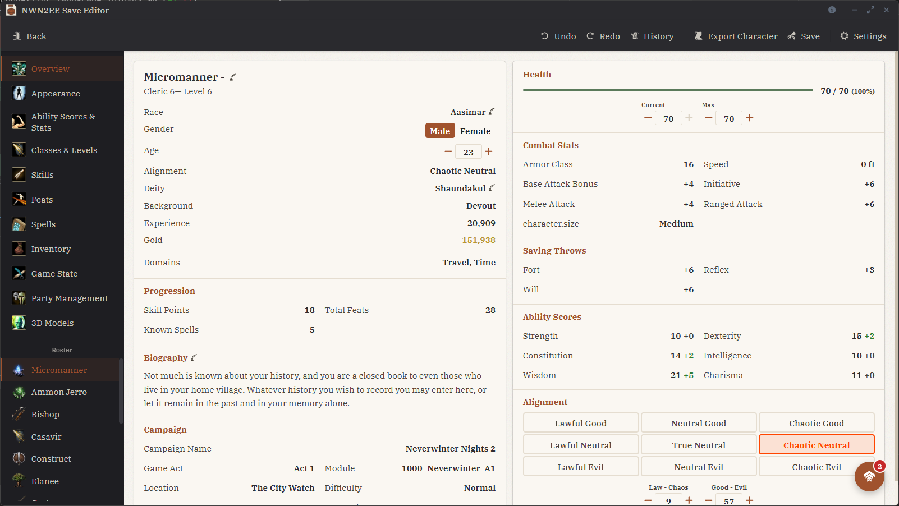
</p>

## Contents

- [Features](#features)
- [Screenshots](#screenshots)
- [Supported Saves](#supported-saves)
- [Requirements](#requirements)
- [Known Limitations](#known-limitations)
- [Building from Source](#building-from-source)
- [Credits](#credits)

## Features

### Character
- Name, gender, age, deity, biography, alignment and hit points
- Ability scores with point-buy respec, racial, level, feat and equipment bonuses shown separately
- Classes and levels: add, change or remove classes, prestige classes, experience and the full level history
- Skill ranks with class and cross-class costs and the skill point budget
- Feats, with missing prerequisites resolved automatically
- Known and prepared spells, domain spells, filters by class, school and level
- Race and subrace with ability adjustments applied
- Animal companion and familiar

### Companions
- Every companion can be edited like the main character: build, feats, spells, inventory and appearance
- Move companions between the active party and the reserve
- Set influence for each companion

### Inventory
- Equip, unequip, stack and delete items, edit gold
- Edit name, description, icon and item properties with the values the game itself offers
- Create items from any base type or add existing item templates, including items from mods
- Change model variant, material, armor accessories and tints with a live 3D preview

### Appearance
- Head, hair, facial hair, wings, tail, body size and voice set
- Skin, eye, eyebrow, hair and tattoo colors
- Live 3D preview that renders the character with equipped armor and accessories as the game does

### Quests
- Browse every quest of the campaign with its journal entries, progress and rewards
- See which dialogue lines lead to each entry and what they change in the game world
- Jump to any quest state. The editor writes the journal entry, the campaign and module variables and the NPC state flags, so the world reacts as if you had played that line

### Game State
- Campaign settings such as level cap, experience cap and companion experience share
- Campaign and module variables

### Backups
- Every save is backed up automatically when you first open it and can be restored at any time
- Each backup lists the changes made since it was taken

### Mods
- Steam Workshop mods, override folders, HAK packs and custom TLK files are picked up automatically
- Custom classes, feats, spells and items appear in the editor like vanilla content

### More
- 3D model browser to search and preview every model in the game data
- Undo and redo with edit history
- Import and export standalone characters (`.bic`)
- Only hard engine limits are enforced. The editor warns where the game itself would crash, such as prestige classes with unmet requirements, and otherwise lets you build what you want
- Available in English, German, Spanish, French, Polish and Russian

## Screenshots

<table>
  <tr>
    <td width="50%">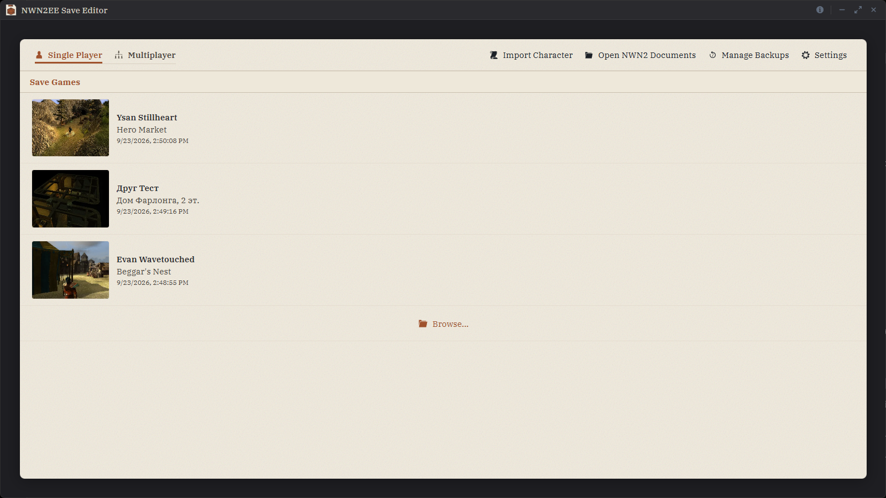<br/><sub>Save picker: every save with its location and time</sub></td>
    <td width="50%">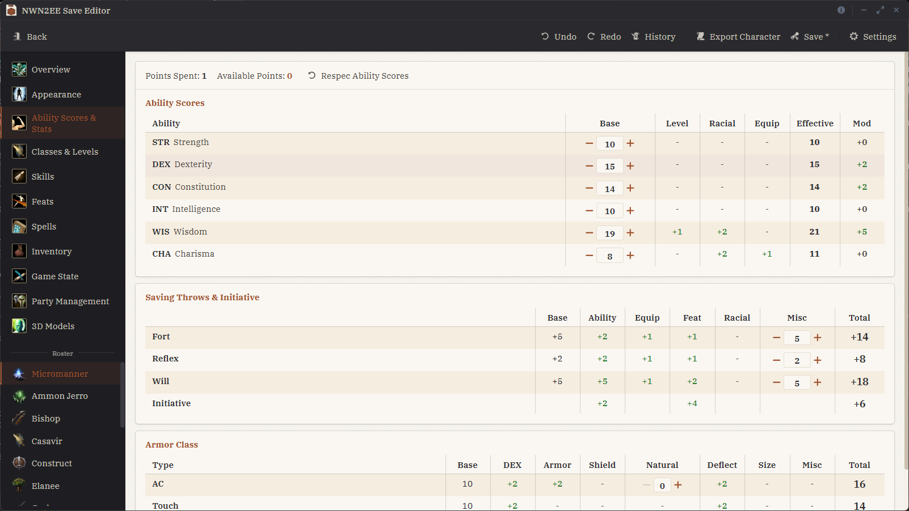<br/><sub>Ability scores: point buy with every bonus shown separately</sub></td>
  </tr>
  <tr>
    <td>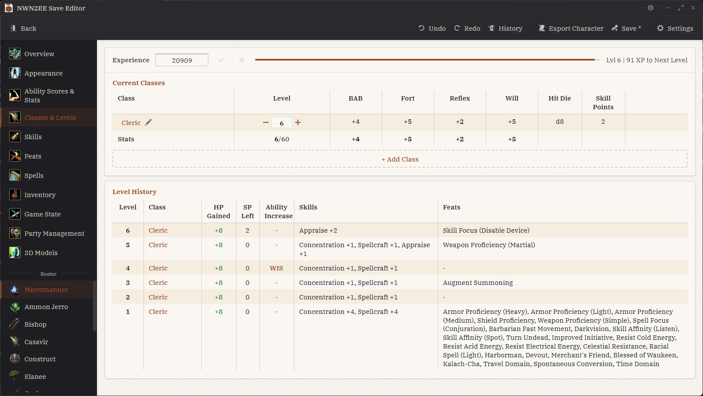<br/><sub>Classes and levels: multiclass with level history</sub></td>
    <td>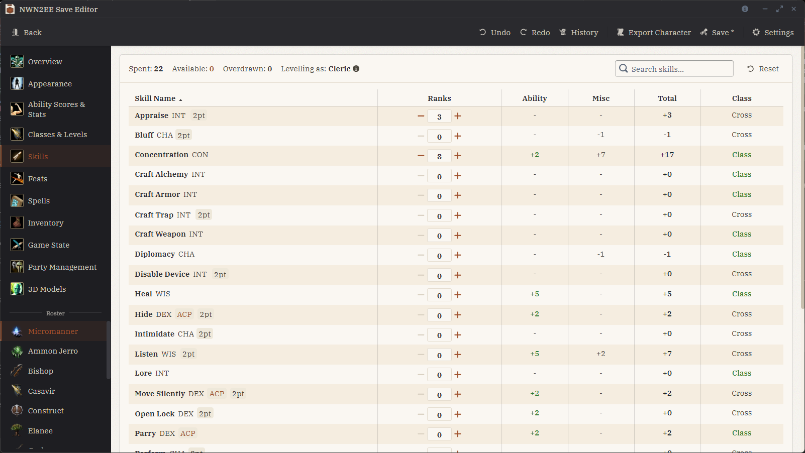<br/><sub>Skills: ranks, costs and the skill point budget</sub></td>
  </tr>
  <tr>
    <td>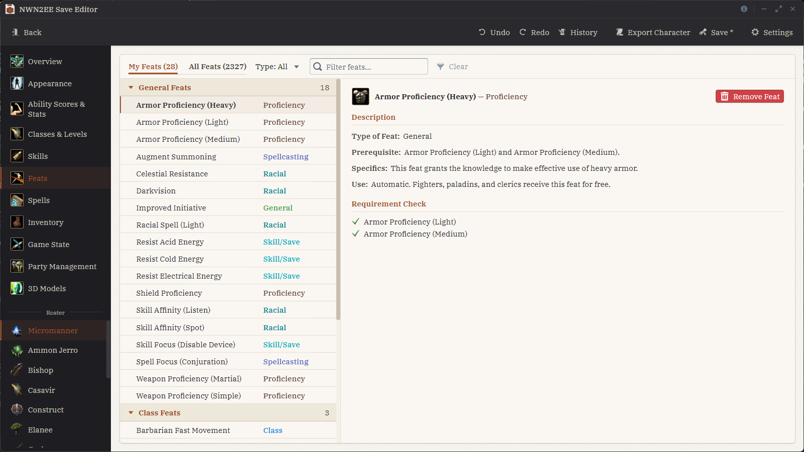<br/><sub>Feats: every feat with its prerequisites</sub></td>
    <td>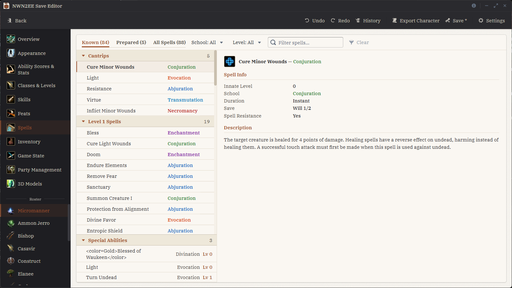<br/><sub>Spells: known and prepared spells by class</sub></td>
  </tr>
  <tr>
    <td>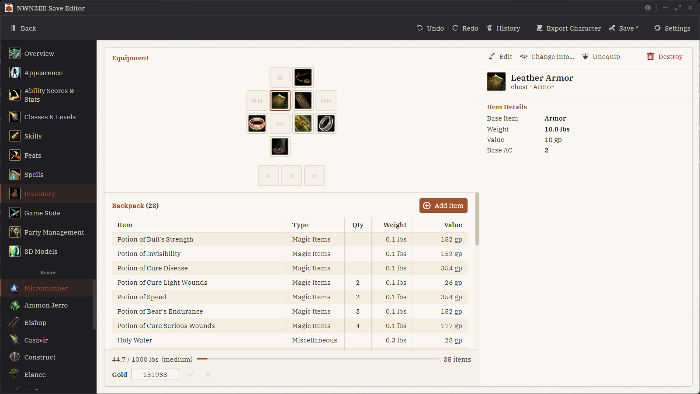<br/><sub>Inventory: item editor with properties and 3D preview</sub></td>
    <td>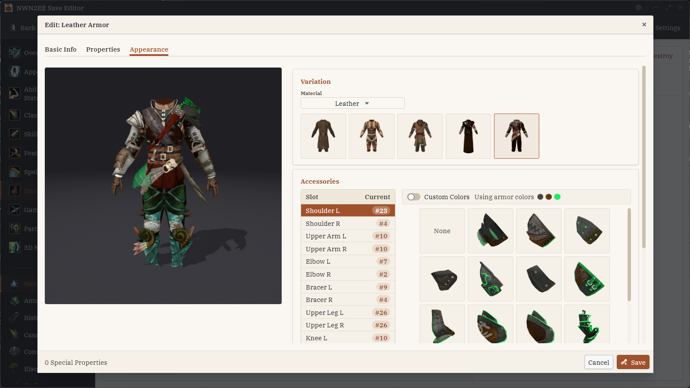<br/><sub>Item appearance: model variant, tints and armor accessories</sub></td>
  </tr>
  <tr>
    <td>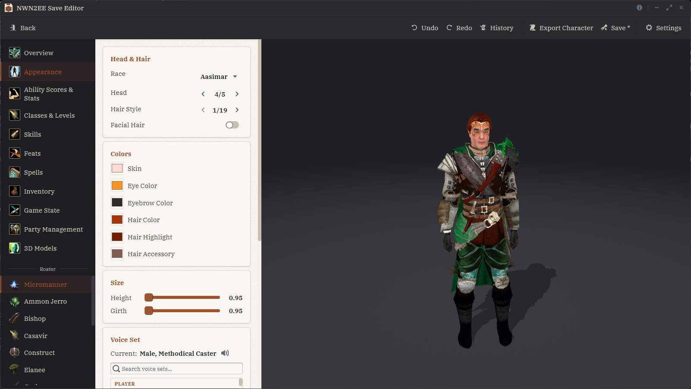<br/><sub>Appearance: live 3D preview with armor and accessories</sub></td>
    <td>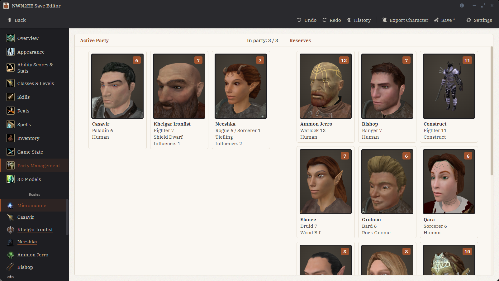<br/><sub>Party: active party and reserve</sub></td>
  </tr>
  <tr>
    <td>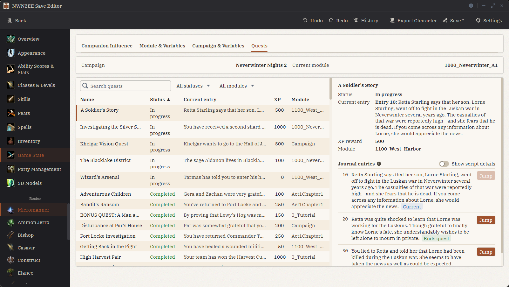<br/><sub>Quests: browse quests and jump to any state</sub></td>
    <td>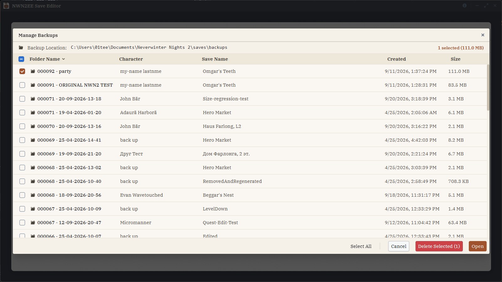<br/><sub>Backups: every save backed up automatically</sub></td>
  </tr>
  <tr>
    <td>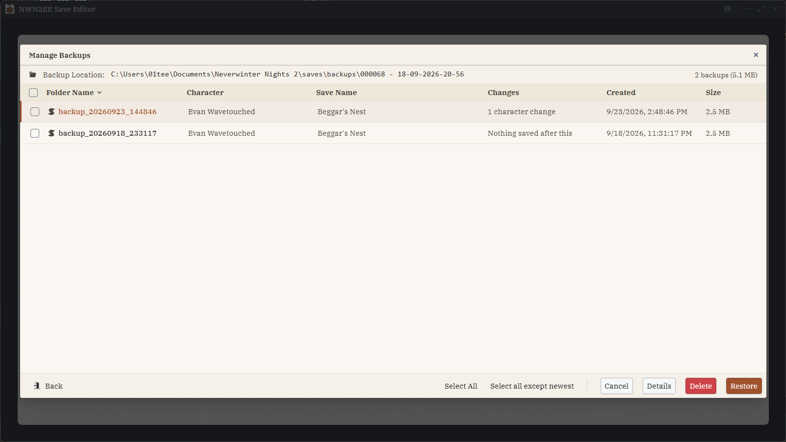<br/><sub>Backup details: the changes made since each backup</sub></td>
    <td>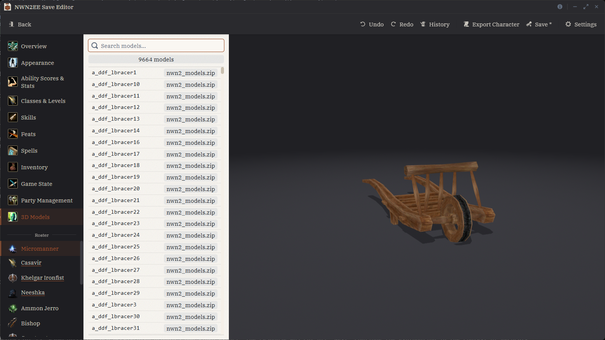<br/><sub>3D models: browse every model in the game</sub></td>
  </tr>
</table>

## Supported Saves

- Neverwinter Nights 2 Enhanced Edition saves
- Original Neverwinter Nights 2 saves
- Standalone characters (`.bic`)
- Single-player and multiplayer saves, including saves with several player characters

## Requirements

- Windows 10 or later, or Linux (AppImage or Deb)
- Neverwinter Nights 2 Enhanced Edition or the original Neverwinter Nights 2
- Quest editing requires Windows and the Enhanced Edition

## Known Limitations

- Quest editing needs Windows and the Enhanced Edition, because it uses the 64-bit toolset libraries that only the Enhanced Edition ships
- Item visual effects are not shown in the 3D preview

## Building from Source

```bash
npm install
npm run tauri:dev      # development
npm run tauri:build    # production build
```

Requires Node.js 20+ and a stable Rust toolchain. Linux additionally needs the Tauri v2 system packages (`libwebkit2gtk-4.1-dev`, `libgtk-3-dev`, `libappindicator3-dev`, `librsvg2-dev`, `patchelf`).

## Credits

- [nwn2mdk](https://github.com/Arbos/nwn2mdk) by Arbos, the MDB and GR2 format reference for the 3D viewer
- Scripterron's Java NWN2 Character Editor, used as a save format reference
- Neverwinter Nights 2 is a product of Obsidian Entertainment; the Enhanced Edition is published by Aspyr Media. This project is not affiliated with or endorsed by either.

Licensed under the [MIT License](LICENSE). Third-party licenses are listed in [THIRD_PARTY_LICENSES.md](THIRD_PARTY_LICENSES.md).
